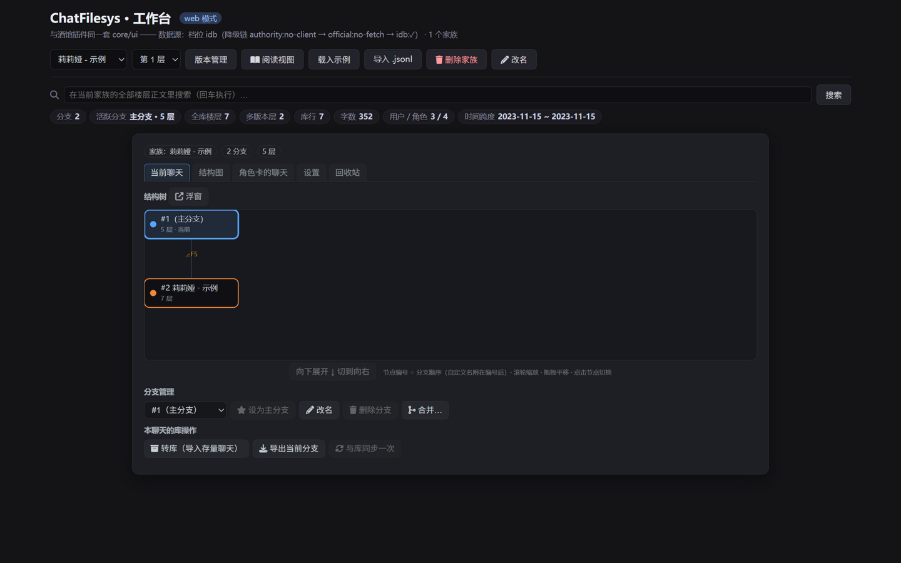
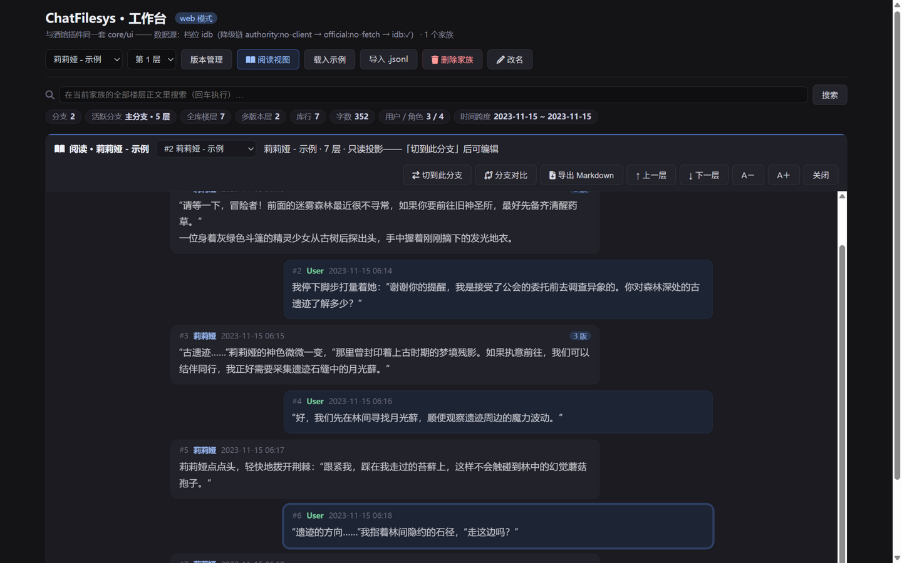
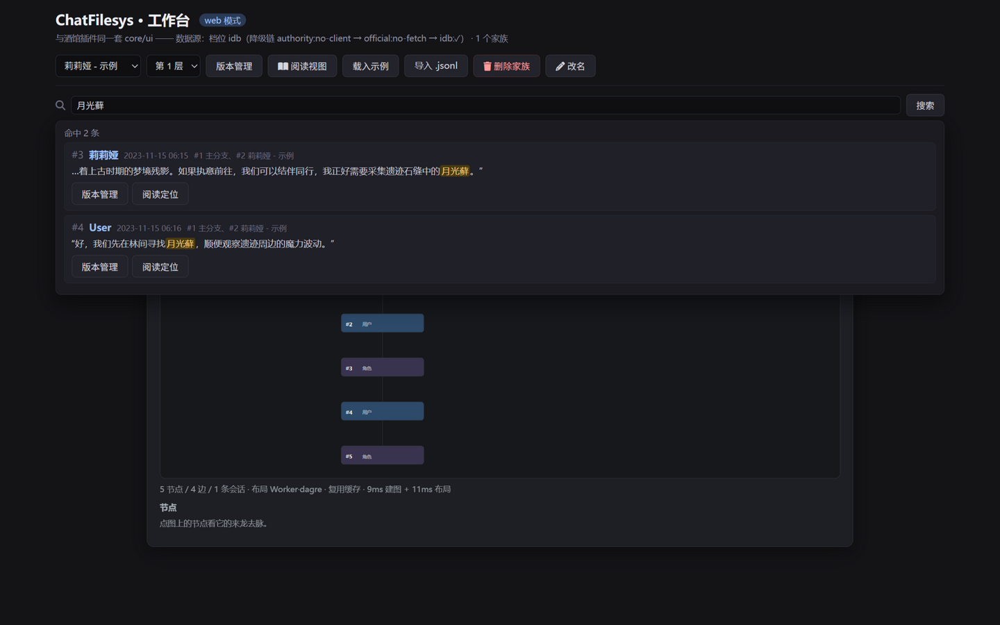
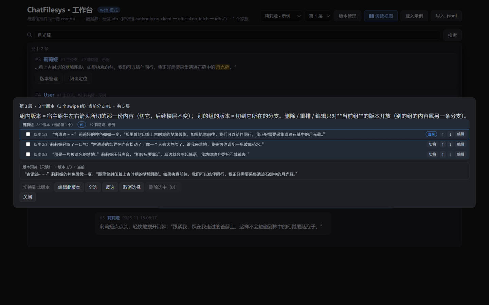
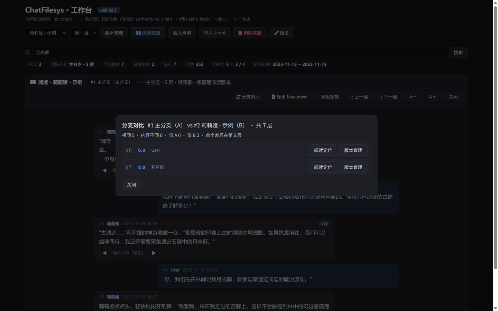
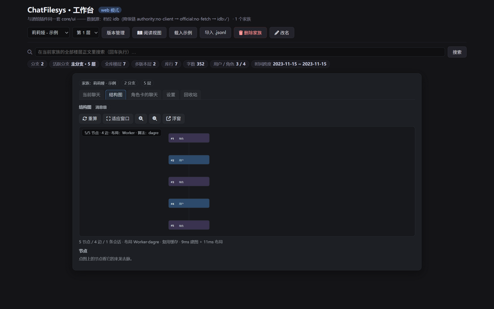

# ChatFilesys — 聊天文件系统（SillyTavern / Luker 前端扩展）

   

> 接管酒馆的聊天文件系统：真正的楼层分支、纯数据库存储（jsonl 仅导出时存在）、fetch 拦截伪装无感、智能合并去重——全部作为**一个前端扩展**实现，零核心修改、零构建安装。

ChatFilesys 是一个 [SillyTavern](https://github.com/SillyTavern/SillyTavern)（及 Luker 分支）的第三方前端扩展，把「分支」从整文件复制变成聊天数据内的结构化组织，把「超大 jsonl 会话文件」变成数据库分片存储：

- **真分支零复制**：分支只存增量（Swipe 组路径），共享前缀永远只有一份——百层聊天分叉不翻倍体积
- **纯数据库模式**：三档存储适配器（Authority SQL → 官方通道分片 → IndexedDB 缓存），jsonl 只在导出时出现
- **生态无感**：fetch 拦截层把 `/api/chats/*` 读写转接数据库并伪造合规响应；渲染管线、原生按钮接管、其他插件操作全部照常
- **结构可视化**：分支级 SVG 结构树 + 消息级结构图（分叉点 / 会话路径一眼看全），均可弹非模态浮窗「边聊边看」
- **web 工作台**：与插件同一套 UI 的独立网页形态——没有酒馆也能查看 / 编辑 / 转换聊天记录

## 截图

| 管理工作台（弹窗五页签） | 阅读视图（分支切换 / 内联版本预览 / 分支对比） |
| --- | --- |
|  |  |

| 全局搜索（命中高亮 + 双跳转） | 楼层版本管理（四能力） |
| --- | --- |
|  |  |

| 分支对比（逐层 diff + 差异层跳转） | 结构图（消息级，Worker·dagre 布局） |
| --- | --- |
|  |  |

> 截图全部来自内置示例数据（虚构角色），不含任何真实聊天。

## 功能一览

**分支与版本**

- 分支管理：切分支 / 改名 / 删除（主分支护城河：删除与「设为主分支」按钮的置灰判据与数据层同一条）/ 设主分支
- 楼层版本管理（分叉点上）：版本预览 / 切换（组内 = 原生 swipe 语义，跨组 = 切分支）/ 多选删除（至少保留一个）/ 重排与就地编辑正文
- 合并：存量 jsonl 再导入时指纹对齐，差异行旁挂成**子分支**（原分支不动，完全一致则幂等零写入）
- 结构树（分支级）与结构图（消息级）：向下 / 向右布局、缩放拖拽、节点详情（上下一跳 / 分叉点标注）、可弹非模态浮窗

**存储与导入导出**

- 三种模式：JSONL 增强（默认，事实源在聊天文件）/ 纯数据库 / 双写（库为事实源 + 防抖落一份标准 jsonl，单向只写不读）
- 三档适配器（纯库模式下自动降级）：Authority SQL → 官方通道隐容器 → IndexedDB
- 导入旅程：入库提醒 → 指纹合并（幂等去重 / 最长公共前缀分叉）→ 源文件进回收站（保留 7 天，可还原 / 立刻清理）
- 导出：当前分支为**纯标准 JSONL**（离开插件仍可读，不带插件命名空间）

**界面与诊断**

- 唯一界面 = 插件弹窗（输入框上方工具图标按钮 / **Alt+B**），五页签：当前聊天 / 结构图 / 角色卡的聊天 / 设置 / 回收站
- 设置中枢：26 项可调设置（含「为什么」说明），支持恢复默认与导出清单 JSON
- 错误面：任何失败聚合在弹窗顶部（编号 + 怎么办 + 折叠的原始信息），不静默、不吞
- 四宿主兼容实测：SillyTavern / Luker / PureTavern / TauriTavern

## web 工作台（没有酒馆也能用）

`web/index.html` 是与插件**同一套 UI**（同一模板源、同一动作语义）的独立网页：静态托管即可用，不需要构建。

- 数据落在浏览器 IndexedDB（缓存档）；页面明示档位徽章，不冒充服务器事实源
- 库面动作真实可用：导入 jsonl（幂等 / 合并为子分支）、切分支、改名、删除分支、设主分支、删除家族、导出、设置、版本管理
- 缺酒馆运行时的能力**置灰并说明原因**（AI 总结 / 双写落盘 / 角色卡聊天列表），不是隐藏
- **阅读视图**：整篇阅读当前分支完整对话（左右气泡 / 楼层号 / 时间 / 多版本角标），点任意一条直接打开该层版本管理
- **全局搜索**：在当前家族全部楼层正文里搜（含其他分支的变体行），命中高亮，一键「版本管理」或「阅读定位」
- **统计概览**：分支数 / 活跃分支层数 / 多版本层 / 字数 / 用户与角色占比 / 时间跨度

本地预览（任选其一）：

```bash
npx --yes http-server . -p 3050 -a 127.0.0.1 -s --cors -c-1
# 打开 http://127.0.0.1:3050/web/index.html
```

## 文档

**完整文档在文档站：<https://jiozhaoyue.github.io/st-chatfilesys-frontend/>**

- [指南](https://jiozhaoyue.github.io/st-chatfilesys-frontend/guide/)：安装与入口、三种模式、三档存储、管理弹窗、分支与版本、导入 / 导出 / 回收站、web 工作台、隐私边界……每个功能一页，每页都写明**边界与未做到**
- [边界与未做到（汇总）](https://jiozhaoyue.github.io/st-chatfilesys-frontend/guide/boundaries)：一眼看全所有限制
- [开发文档](https://jiozhaoyue.github.io/st-chatfilesys-frontend/dev/)：架构、接缝、适配器契约、宿主兼容、测试基建、[Authority 后端接入指导](https://jiozhaoyue.github.io/st-chatfilesys-frontend/dev/authority-backend)
- [路线图](https://jiozhaoyue.github.io/st-chatfilesys-frontend/dev/roadmap)：计划的唯一权威出处

## 安装

**方式一（推荐）：** 酒馆「扩展管理器」填 Git URL 一键安装：`https://github.com/jiozhaoyue/st-chatfilesys-frontend`（扩展在 `public/scripts/extensions/third-party/chatfilesys/`，安装即用、无需任何构建步骤）。

**方式二（手动）：** 把 `public/scripts/extensions/third-party/chatfilesys/` 整个目录复制到实例的 `data/<user-handle>/extensions/chatfilesys/`（Luker 用户私有扩展**平铺**在该目录，不要嵌套 `third-party`），重启服务后在扩展设置中启用。

- 唯一界面 = **插件弹窗**：入口是输入框上方那排工具图标里的插件按钮，或用快捷键 **Alt+B**
- 聊天界面只有两样：上面那个入口按钮，以及消息旁的**版本按钮**（仅该层有多个 swipe 组时出现）
- 扩展设置抽屉里不放任何东西（设置项在弹窗的「设置」页签里）
- **打开一个还没入库的聊天时会弹一次入库提醒**：两个模式短按钮「纯库」／「双写」、一个「不入库」，外加「这个聊天不再提醒」／「全部不再提醒」。关掉窗口等于「不入库」，压制记录只存在扩展设置里

## 工作原理

三种模式并存（弹窗「设置」页签里三选一；出厂默认 JSONL 增强）：

**纯数据库模式**（fetch 接缝 + 三档适配器）：插件在全局 `fetch` 上装一层接缝，拦截 `/api/chats/*` 的读/写请求，转接数据库分片并伪造合规响应——渲染管线与宿主按钮零改动，其他插件无感。

```
酒馆 UI ──fetch /api/chats/*──► 接缝层 ──► 三档适配器 ──► 家族 / 楼层 / 变体 / 分支路径
                                  │
                          非聊天请求原样透传；未接管的聊天原样透传
```

- **家族（Family）**：一个角色名下互为分支的聊天集合；**楼层（Floor）**：一条消息一层，家族内全局编号；**变体（Variant）**：楼层内内容候选（酒馆原生 swipe）；**分支（Branch）**：从分叉点起的变体引用序列，只存引用不复制内容
- 磁盘上的 jsonl 只在导出时生成；导入存量的智能合并走内容指纹（hash 去重 + 最长公共前缀分叉）

**JSONL 增强模式**（兼容形态，未启用纯库时）：

```
聊天文件（.jsonl）
├── 第 1 行 header.chat_metadata.extensions.chatfilesys   ← 分支树模型（惰性元数据）
│     { active_branch, branches:[{ id, name, fork_base, path }], groups:{ 折叠组 } }
└── 第 2 行起 = 活跃分支的楼层线性序列（body 投影）
```

- 分支切换/删层由投影层（`core/projection.js`）diff 出 RFC6902 操作，经写路径适配层（`core/chat-writer.js`）映射为**官方消息 API**（`deleteMessages`/`addMessages`/`updateMessages`）批量执行；元数据随官方持久化自动同车落盘
- 事实源在服务器聊天文件；浏览器不做任何持久化副本

**双写模式**（库是事实源 + 磁盘保留标准聊天文件）：

```
库（事实源）──写成功后标脏──► 防抖 1.5 秒 ──► 原生通道写一份标准 jsonl
                                              （绕开接缝，不回环）
```

- 库改一次就同步一份标准格式的聊天文件到磁盘，别的工具与备份流程照常能看到文件
- 方向是**单向的：只写不读**——磁盘那份是副本，反向的改动不采纳（避免双向冲突）
- 「库 → 关闭」会先强制落一次文件、失败即中止切换；「双写 → 纯库」停止落文件，磁盘文件保留为快照

**两种模式都有的动作**：可显式「设为主分支」——主分支 = 打开这个聊天看到的那条分支。主分支不能直接删，要先换成别的分支再删；库里的家族主键绑定会跟着同一次落库改到目标分支上。

机制细节见 [`docs/pure-db-mode-explained.md`](docs/pure-db-mode-explained.md)（人话说明，不写代码）。

## 开发与测试

```bash
# 数据库单测（node:test，直接 import 扩展源码；含接缝/三档适配器/指纹合并/回收站/导入旅程/图栈/工作台）
node --test tests/branches/*.test.mjs   # 44 个测试文件 / 641 项

# e2e（Playwright 驱动本地 Dev 实例，测试角色前缀 __cb_e2e，自动清理）
# Windows 下必须带 PYTHONIOENCODING=utf-8（断言明细含非 GBK 字符，否则打印即崩）
pip install playwright && python -m playwright install chromium
python tests/e2e/smoke.py               # 冒烟
python tests/e2e/test_web_workbench.py  # web 工作台（同构挂载/库面动作/置灰）
python tests/e2e/test_pure_db_full_journey.py  # UI 全旅程（库内容渲染 / 发消息入库 / 版本号闭环）
python tests/e2e/test_chat_record_fidelity.py  # 聊天记录零丢失（聊天头整份往返 + 字段级补丁）
python tests/e2e/test_swipe_versions.py        # 每层版本管理（四项能力 / 两种切换语义）
python tests/e2e/test_main_branch.py           # 主分支可换（灰化 / 确认 / 库内不变式）
python tests/e2e/test_host_compat.py           # 四宿主兼容（SillyTavern/Luker/PureTavern/TauriTavern）
python tests/e2e/run_suite.py                  # 套件入口
```

e2e 依赖本地 Dev 实例（默认 `https://127.0.0.1:8003`，可在 `tests/e2e/harness.py` 改 `BASE`）。
真实验证一律在实例里做，不另做独立演示页。

> **串行纪律（实测教训）**：所有用例共用同一台实例。并发跑会让彼此的模式切换与聊天重载互相打断——已实测过一次 `test_main_branch.py` 的 ④ 在并发下失败、独占重跑即全绿。harness 之外，跑之前还要把插件目录同步到实例的 `data/<user-handle>/extensions/chatfilesys/`（harness 不会替你同步）。

## 路线图

计划的**唯一权威出处**是文档站的[路线图](https://jiozhaoyue.github.io/st-chatfilesys-frontend/dev/roadmap)页。此处只留一句概要：

- ✅ 一期：分支数据层 + 写路径 + 原生书签收编 + 增量导出
- ✅ 二期：UI 重构（管理弹窗 + 消息旁轻量注入）+ SVG 分支树 + 写路径迁移官方消息 API
- ✅ 三期：**纯数据库模式核心**：fetch 拦截接缝 + 三档存储适配器 + 导入旅程（智能合并 + 回收站）+ 读库渲染
- ✅ 四期：图视图（数据源 / 引擎 / 布局 / 渲染交互）+ 每层版本管理 + 分支合并 + 设置中枢 + 四宿主兼容 + **web 同构工作台**（阅读视图 / 全局搜索 / 统计概览）
- 🚧 五期（进行中）：导出家族压缩包 / 解绑重绑 / 多聊天并发写实测 / 档 1 性能基准 / 插件入口接入工作台控制器

## License

[AGPL-3.0](LICENSE)——与 SillyTavern 上游一致。

### 第三方库（本地副本，无构建步骤）

| 库 | 版本 | 用途 | 许可 | 位置 |
| --- | --- | --- | --- | --- |
| [dagre](https://github.com/dagrejs/dagre) | 0.8.5 | 图布局（分支图算坐标） | MIT | `public/scripts/extensions/third-party/chatfilesys/vendor/dagre.js` |
| [Font Awesome](https://fontawesome.com/) | 6.5.1 | 图标（web 工作台；插件形态用宿主自带） | CC BY 4.0 / OFL / MIT | `web/vendor/fontawesome/` |

副本**原样不改**（仅保留原有许可头），安装即用、无需 `npm install`。
